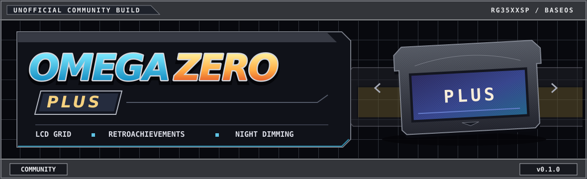
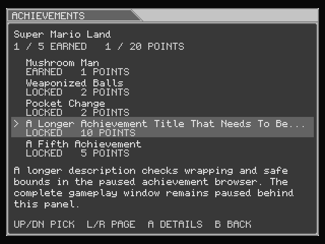

## About this fork

**Omega Zero Plus** is an unofficial community build of [Omega-Zero](https://github.com/oauramos/omega-zero), a cartridge-shelf frontend for Anbernic handhelds running BaseOS. I started with the LCD grid and added RetroAchievements, an in-game achievement browser, and extra dimming for nighttime play.

I tested this build on the **RG35XXSP (640 × 480) running BaseOS**. The release updates the frontend on an existing Omega-Zero card and uses the emulator cores already on it.

## What’s in this build

| Feature | How to use it |
| --- | --- |
| **LCD grid and screen filters** | Press **Select + X** in-game to cycle through the screen looks from upstream PR #33, including LCD, dot, grid, scanlines, and CRT. |
| **Softcore RetroAchievements** | Enable the optional config for GB, GBC, GBA, and SNES. Select **Snes9x** for SNES tracking. Cached games can earn achievements offline and sync them when you reconnect. |
| **Achievement browser** | Press **Select + Start** in-game to pause and view earned and locked achievements, points, and requirements. Use the D-pad to browse, **A** for details, and **B** to go back. |
| **Quieter notifications** | Game-ready and unlock messages appear in-game. Routine internet reminders and sync confirmations stay hidden while syncing continues. |
| **14 brightness levels** | Press **Select + Up/Down**. The brightness bar shows all 14 levels, including the extra dim settings. Your chosen level is saved. |
| **Achievement troubleshooting logs** | The log helps distinguish configuration, login, and ROM recognition problems without printing your credentials. |

## Install

1. Download the [RG35XXSP release ZIP](https://github.com/lorussomj-stack/omega-zero/releases/download/v0.1.0-community/omega-zero-community-v0.1.0-rg35xxsp.zip) and extract it.
2. Power off the handheld and back up the existing `System/omega-zero` on your Omega-Zero card.
3. Copy the ZIP’s `System/omega-zero` into the card’s `System` folder, eject the card safely, and boot.
4. To roll back, power off and restore the executable you backed up.

Starting with a fresh card? Install BaseOS and upstream Omega-Zero first, then apply the update. [Upstream installation guide](https://oauramos.github.io/omega-zero/#install)

### Enable RetroAchievements

Copy the included `Config/retroachievements.toml.example` into the card’s `Config` folder as `retroachievements.toml`. Fill in your login locally, connect to Wi-Fi, and restart Omega-Zero. Keep the filled file private. Use a supported ROM revision and select **Snes9x** for SNES achievements.

## In-game preview

  
   <em>Achievement browser rendered from the fork with sample data.</em>

## Source and build

The release ZIP includes the matching source archive, license notices, install instructions, and a blank RetroAchievements template. The build workflow checks out the pinned upstream shader commit and applies this fork’s patches. [Build workflow](.github/workflows/ra-night-fix.yml) · [Release notes and downloads](https://github.com/lorussomj-stack/omega-zero/releases)

## Credits and AI disclosure

- **Otávio (@oauramos)** created Omega-Zero, which builds on **Brandon T. Kowalski’s** Slot. [Omega-Zero](https://github.com/oauramos/omega-zero) · [Slot](https://github.com/BrandonKowalski/slot)
- **Norman Steinmeier** integrated the screen looks in Omega-Zero PR #33. The shader work draws on **Gigaherz’s LCD3x**, **Themaister’s dot shader**, and **Greg Hogan’s (SoltanGris42) grid line weighting** from `zfast_lcd_standard`, by way of Slot and libretro’s shader collection. The scanline and CRT looks come from Omega-Zero. [PR #33](https://github.com/oauramos/omega-zero/pull/33) · [libretro shaders](https://github.com/libretro/glsl-shaders)
- **pvaibhav** created BaseOS and maintains the Slot fork whose RetroAchievements integration was adapted here. Thanks to the **RetroAchievements and rcheevos contributors** for the service and evaluator. [BaseOS](https://github.com/pvaibhav/BaseOS) · [Slot fork](https://github.com/pvaibhav/slot) · [rcheevos](https://github.com/RetroAchievements/rcheevos)
- **Qwerasd205** created the Pixel Code font used by Omega-Zero. [Pixel Code](https://github.com/qwerasd205/PixelCode)

I chose the features and tested the builds on my own RG35XXSP. I used **OpenAI Codex** to help adapt and write code, debug issues, run tests, package the release, and put together this README.

This fork is distributed under [GPL-3.0-or-later](LICENSE). If you run into a problem with this build, report it in [this fork’s issues](https://github.com/lorussomj-stack/omega-zero/issues).
